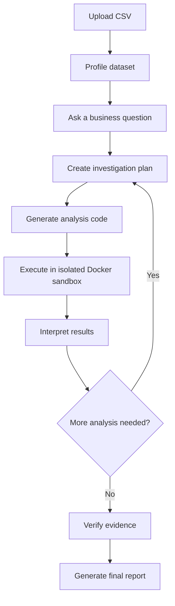

<div align="center">

# CSV Analyst Agent

### From raw CSV files to evidence-backed answers.

An AI-powered data investigation platform that aims to do more than answer questions about a dataset. It plans an investigation, runs analysis, gathers evidence, and works toward conclusions that can be checked against the underlying data.

<br />

**Python · Django REST Framework · PostgreSQL · Redis · Celery · LangGraph · Pandas · DuckDB**

<br />

</div>

---

## The idea

Most CSV chat tools take a question, generate an answer, and stop there.

**CSV Analyst Agent is being built to investigate the question.**

Imagine uploading sales data and asking:

> Why did our revenue drop this month?

Instead of jumping straight to a conclusion, the intended workflow is to inspect the dataset, create testable hypotheses, run appropriate analyses, compare the results, and collect evidence before presenting findings.

The goal is to make data analysis more systematic, transparent, and useful—not to make an LLM sound confident.

## What it aims to do

- Accept CSV datasets and inspect their structure.
- Profile data to understand its quality and shape.
- Clean datasets through configurable operations.
- Turn a business question into a structured analysis plan.
- Execute analysis code in an isolated Python environment.
- Interpret execution results and decide what to investigate next.
- Verify findings against collected evidence.
- Produce a clear report with traceable results.

> **Project status:** This is an active work in progress. The dataset-management, profiling, cleaning, and investigation API foundations are implemented. The autonomous execution, verification, and reporting workflow is still under development.

## Current implementation

| Area | Status | Details |
|---|---|---|
| Dataset management | ✅ Implemented | Upload, list, retrieve, and delete CSV datasets |
| Dataset profiling | ✅ Implemented | Row and column counts, duplicates, missing values, and column details |
| Data cleaning | ✅ Implemented | Remove duplicates, handle missing values, convert types, and rename columns |
| Cleaning report | ✅ Implemented | Reports changes such as rows removed, values filled or removed, renamed columns, and execution duration |
| Background processing | ✅ Implemented | Celery tasks for time-consuming dataset processing |
| Investigation API | ✅ Implemented | Create an investigation with a dataset, question, and goal |
| LangGraph planner | 🛠️ In progress | Generate a structured analysis plan from the question and dataset profile |
| Python execution sandbox | 🛠️ In progress | Adapt an existing Docker-based runner for generated data-analysis code |
| Result analysis and evidence verification | 📌 Planned | Interpret actual execution results and validate findings |
| Final report generation | 📌 Planned | Present conclusions with supporting evidence |

## How the investigation workflow is designed

The target workflow is an iterative investigation—not a single LLM response.



The workflow is being orchestrated with **LangGraph**. Django is responsible for the application APIs and persistence, while Celery handles long-running background work.

## Technology stack

| Technology | Purpose |
|---|---|
| Python | Core application and analysis logic |
| Django REST Framework | Backend APIs |
| PostgreSQL | Persistent application and investigation data |
| Redis | Celery broker and supporting background-processing infrastructure |
| Celery | Asynchronous dataset-processing tasks |
| LangGraph | Orchestration of the investigation workflow |
| LangSmith | LLM workflow tracing and debugging |
| Pandas | Dataset inspection and manipulation |
| DuckDB | Planned analytical query engine |
| Docker | Isolated execution environment for generated Python code |
| Cloudinary | Dataset file storage |

## Data processing capabilities

### Dataset profiling

The profiling pipeline inspects a CSV and records information including:

- Number of rows and columns
- Duplicate row count
- Missing-value counts by column
- Column names and data types

### Data cleaning

The cleaning engine currently supports:

- Removing duplicate rows
- Dropping rows with missing values
- Filling missing values
- Converting column data types
- Renaming columns

A cleaning report records the changes made so the result is not just a modified file with no explanation.

## Example investigation

**Question:** Why did revenue decrease?

The agent could investigate several possible explanations, depending on the available columns and data:

1. Did the number of orders decrease?
2. Did the average order value change?
3. Did failed or cancelled payments increase?
4. Did performance change in a particular product category or region?

These are investigation hypotheses, not assumed facts. The system must test them against the uploaded data and should be able to report when the available evidence is insufficient.

## Architecture principles

A few principles guide the implementation:

- **Evidence before conclusions:** Findings should be supported by actual analysis results.
- **Controlled execution:** Generated Python code should run outside the Django application process, with restricted resources and no network access.
- **Reliable background work:** Long-running processing belongs in background tasks rather than blocking API requests.
- **Traceable investigations:** Plans, execution outputs, errors, and evidence should be recorded as the workflow develops.
- **Honest uncertainty:** The agent should not invent missing data or force a conclusion when evidence is weak.

## Local development

The project is under active development, so the exact environment configuration and setup commands may change. The general setup is:

1. Clone the repository.
2. Create and activate a Python virtual environment.
3. Install the project's Python dependencies.
4. Configure PostgreSQL, Redis, and the required environment variables.
5. Apply Django migrations.
6. Start the Django development server and Celery worker.
7. Build and configure the Docker runner image before testing sandbox execution.

```bash
git clone <your-repository-url>
cd <repository-directory>

python -m venv .venv
source .venv/bin/activate       # macOS / Linux

pip install -r requirements.txt
python manage.py migrate
python manage.py runserver
```

Start the Celery worker using the app's configured Celery application, and configure the database, Redis, file storage, and LLM credentials according to your local environment. The commands above are a starting point; they may need adjustment to match the repository's current settings and app layout.

## Roadmap

- [x] Dataset upload and management APIs
- [x] Automated dataset profiling
- [x] Configurable data-cleaning pipeline
- [x] Background processing with Celery
- [x] Investigation creation API
- [x] Initial structured analysis planner
- [ ] Connect planner output to the analysis executor
- [ ] Execute generated code in the isolated Docker runner
- [ ] Add result interpretation and iterative investigation
- [ ] Add evidence verification
- [ ] Generate final investigation reports
- [ ] Add automated tests and end-to-end reliability checks

## Why this project?

I am building this project to explore the engineering behind useful AI agents: not just prompting an LLM, but combining APIs, data pipelines, background jobs, workflow orchestration, controlled code execution, and verification into one system.

It is a work in progress, and I plan to keep improving it as I solve the engineering problems along the way.

---

<div align="center">

**Built with curiosity, Python, and a lot of debugging.**

</div>
